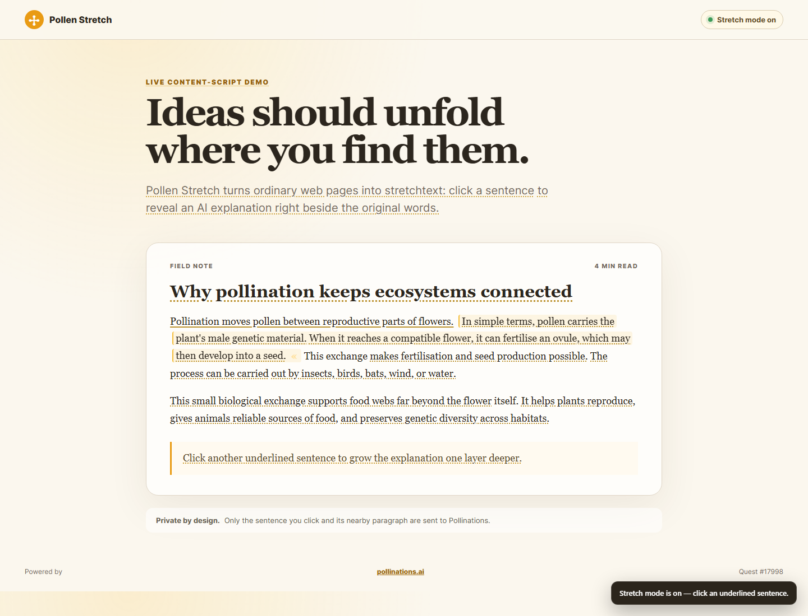

# Pollen Stretch

Turn any article into stretchtext: click an underlined sentence and it grows in place with useful context from Pollinations AI. Click `«` and it folds back without losing your place.

[](https://pollinations.ai/?ref=badge)



## What it does

- Works on ordinary HTTP and HTTPS pages without changing their original links or controls.
- Segments readable paragraphs into keyboard-accessible sentences.
- Generates one to three new sentences only when the reader asks for them.
- Supports nested stretches for a second level of detail.
- Uses Pollinations Device Flow, so each reader approves a budget and pays with their own Pollen.
- Keeps the temporary key in `chrome.storage.session`; content scripts never receive it.
- Inserts generated content as text, never executable HTML.

The interaction is inspired by Ted Nelson's stretchtext and by [cc-stretch](https://github.com/pro-vi/cc-stretch). Pollen Stretch is an independent implementation for web pages and does not copy cc-stretch code.

## Install locally

1. Download or clone this repository.
2. Open `chrome://extensions` or `edge://extensions`.
3. Turn on **Developer mode**, choose **Load unpacked**, and select this repository folder.
4. Open an article, select the Pollen Stretch icon, and connect with Pollinations.

## Use

1. Open the extension popup and choose **Connect with Pollinations**.
2. Approve the temporary key and budget in the Pollinations tab.
3. Reopen the popup, choose **Check authorization**, and turn on stretch mode.
4. Click an underlined sentence to grow it. Click the sentence or `«` to fold it back.

The popup offers quick, deeper, and expert expansion levels. The generated words use the language of the current page.

## Interactive demo

Open `demo/index.html` to try the exact production content script with a deterministic local response. The demo makes no network requests and is used to verify the inline interaction and screenshot.

## Development

No build step is required. The repository contains only local extension code; there is no remotely hosted JavaScript.

```bash
npm install
npm test
npm run check
```

## Permissions

| Permission | Why it is needed |
| --- | --- |
| `activeTab` | Turn stretch mode on for the page chosen by the user. |
| `storage` | Keep the temporary key in session storage and the depth preference locally. |
| `enter.pollinations.ai` | Request and exchange the Device Flow code. |
| `gen.pollinations.ai` | Generate the requested stretch with the user's key. |

See [PRIVACY.md](PRIVACY.md) for the exact data flow.

## Quest

Built for [Pollinations Quest #17998](https://github.com/pollinations/pollinations/issues/17998).

## License

MIT
